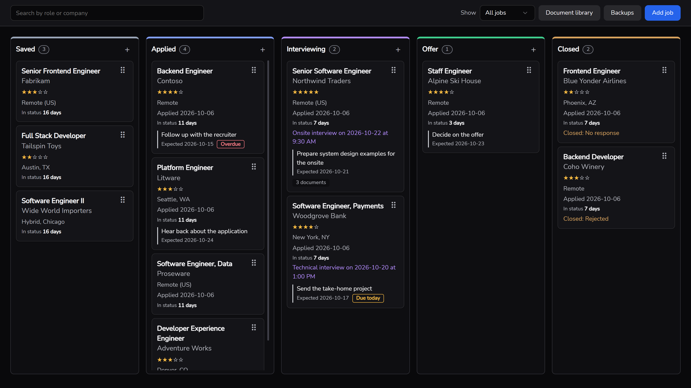
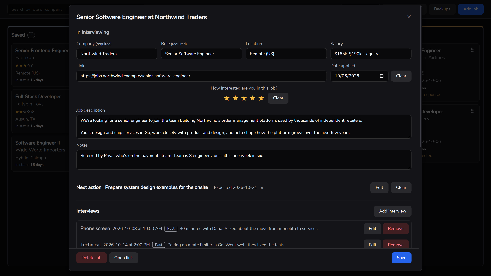
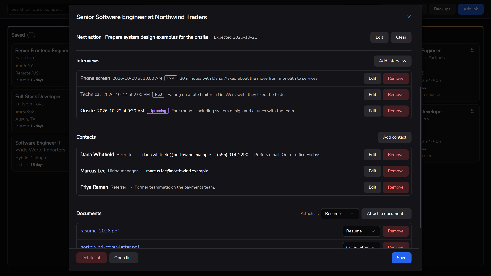
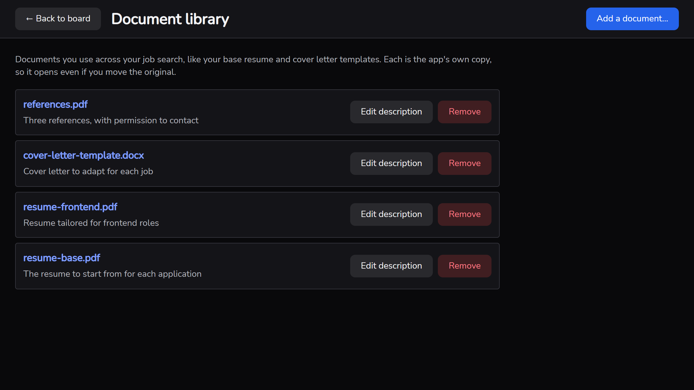
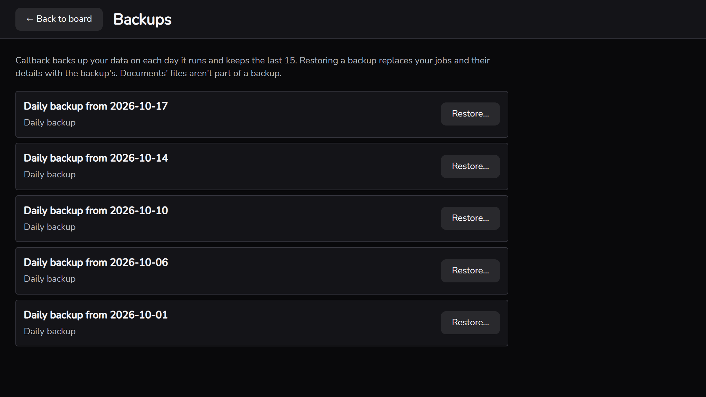

# callback

A desktop app for tracking a job search, built with AI coding agents in a codebase designed so
agents can find, build, and check their own work. Each job you're applying to is a card on a
Kanban board, laid out by status, with its details, contacts, interviews, next action, and the
documents you sent. Your own AI agent can work with the same data through a command line program
shipped beside the app.



## How this was built

callback went from an empty Wails template to a working app in one day, October 9, 2026, after
the template and the `/bdd-feature` skill went in the night before. Most of
that day went into the system for building it rather than the app itself: the harness and the
decisions came first, and then the harness built the app. The commit history shows the order:

| Time | Phase | What happened |
|---|---|---|
| 09:00–10:05 | **Harness** | Spec annotations linking code and tests to scenarios; the `/adr` skill; the grep-complete design (ADR 0001); `speclint`, run by a Stop hook on every agent turn |
| 10:30 | **Spec** | The job board, job cards, and job documents written as scenarios with IDs and statuses |
| 11:16–15:44 | **Decisions** | ADRs 0002–0014: the desktop shell, database, driver, queries, migrations, frontend, storage, testing, styling, data access, drag and drop, and checks, each with the alternatives rejected |
| 16:11–17:01 | **Foundation** | Database opening and the first migration; speclint extended to SQL; the `/feature` skill; one check script, run by the Stop hook |
| 17:01–18:58 | **Build** | The Go backend, then the React frontend, built by `/feature` against the specs, annotated and tested at every layer |
| 19:28–19:45 | **Hardening** | `spectrace` to show each scenario's links layer by layer; package installs denied to the agent |

The three features were built in about two hours, after about eight hours of setup, and every
scenario traces from spec to SQL to UI. All of the app's code was built through `/feature`; only
the tooling around it (speclint, spectrace, the hook, and the check script) was written outside
it. See it with `git log --reverse`.

> **Note:** speclint and spectrace now live in their own repository,
> [SloanGwaltney/speclint](https://github.com/SloanGwaltney/speclint), included here as a git
> submodule at `tools/speclint/`. They were first built in this repository as part of the effort
> described here, and this section tells it as it happened then. Moving them out is the
> "harness carries over" point below put into practice.

**The eight hours weren't spent on this app. They were spent on a foundation, and the app was
the first thing built on it.** None of it is thrown away when the next feature comes along:

- **The next feature starts at the build step.** The stack, data model, testing approach, and
  conventions are already decided and recorded, so the next feature doesn't revisit them. It goes
  straight from `/bdd-feature` to `/feature`, with speclint and the Stop hook holding it to the
  same standard as everything before it.
- **The decisions are a base to build on, not a finished plan.** Each ADR records why a choice
  was made and what was rejected, so a later feature can extend it with confidence, or supersede
  it with a new ADR when it no longer fits, instead of guessing at intent.
- **The harness carries over to other projects.** The annotation format, speclint, spectrace,
  the check-on-every-turn Stop hook, the dependency guardrails, and the `/bdd-feature` and `/adr`
  skills don't depend on this app; they need only specs in `features/`, ADRs in `docs/adr/`, and
  code in Go, TypeScript or JavaScript, or SQL. `/feature`'s workflow (plan, build from storage
  up, annotate, test, trace, then hand off for sign-off) carries over too; only its build steps
  name this stack. The stack ADRs and spectrace's layer names are the parts specific to
  callback.

The two-hour build is the payoff: once the foundation exists, a detailed spec becomes working,
tested, traceable code quickly, and keeps doing so for each feature after it.

It kept doing so. In the week after, in spare hours between other work and life, the same loop
added CI and tagged releases, then 15 more features: search and pagination, interest ratings,
contacts, interviews, next actions, status history, a document library, daily backups, data
version checks, and a command line for the user's own agent. The specs grew from 3 features to 18
and nearly 300 scenarios, and the ADRs to 26. The foundation stayed largely the same throughout,
with changes made along the way as needed to better support AI-driven development.

## Built for AI agents

Most of callback's code is written by Claude Code. The interesting part of this repo isn't the
app; it's the structure around it, which makes agent-written code traceable and checkable:
every behavior is specified first, every line that implements or tests it links back to that
spec, and tools verify those links on every turn the agent takes.

### Every behavior traces from spec to SQL to UI

Each feature starts as plain-language scenarios in [features/](features/), every one with a
stable ID and a status:

```gherkin
@status:implemented @id:card-shows-document-count
Scenario: The card shows that documents are attached
  Given I have a job for "Software Engineer" at "Acme" with 2 attached documents
  When I look at the card on the board
  Then the card shows that it has 2 documents
```

The code that implements a scenario names its ID on an `@scenario` line at each entry point,
from the Wails binding to the React component, and every test that checks it names the scenario
and each step it carries out:

```ts
// @scenario [#card-shows-document-count]
it("shows how many documents are attached", () => {
  // @given [features/job-documents.feature] I have a job for "Software Engineer" at "Acme" with 2 attached documents
  // @when [features/job-documents.feature] I look at the card on the board
  render(<JobCard card={card(1, "Acme", { documentCount: 2 })} onOpen={() => {}} />);

  // @then [features/job-documents.feature] the card shows that it has 2 documents
  expect(screen.getByText("2 documents")).toBeInTheDocument();
});
```

So a text search for a scenario ID or a step finds everything about it: its code, its tests,
and the decisions behind it. How the links are written is in
[docs/spec-annotations.md](docs/spec-annotations.md). The codebase is **grep-complete**
([ADR 0001](docs/adr/0001-design-the-codebase-to-be-grep-complete.md)), which is how an agent
starting cold finds its way around without reading everything. `spectrace` lays it out layer by
layer:

```
$ go run -C tools/speclint ./cmd/spectrace -root ../.. card-shows-document-count

Scenario: The card shows that documents are attached
  features/job-documents.feature:29  @id:card-shows-document-count  @status:implemented

Entry points (@scenario)
  storage test   internal/db/store_test.go:257                @scenario
  service test   internal/jobs/board_test.go:76               @scenario
  Wails binding  app.go:74                                    @scenario
  frontend       frontend/src/components/JobCard.tsx:21       @scenario
  frontend test  frontend/src/components/JobCard.test.tsx:30  @scenario

...

Then the card shows that it has 2 documents  (features/job-documents.feature:32)
  storage test   internal/db/store_test.go:277                @then
  service test   internal/jobs/board_test.go:88               @then
  frontend test  frontend/src/components/JobCard.test.tsx:36  @then

Fully linked: @scenario in code and tests, and all 3 steps in tests.
```

### The links are enforced, not hoped for

- **`speclint`** ([SloanGwaltney/speclint](https://github.com/SloanGwaltney/speclint), a
  submodule at `tools/speclint/`) fails on any annotation that doesn't
  match the spec word for word, uses the wrong keyword, or points at a missing or withdrawn
  scenario, and on any implemented scenario with no `@scenario` link in code and tests, or step
  with no link in tests.
- **One script** ([scripts/check.sh](scripts/check.sh)) runs speclint alongside gofmt, `go vet`,
  `tsc`, Biome, and every test, so the agent, a person, and a pipeline all check the same thing.
  The agent runs it on every turn (see the Stop hook below), and GitHub Actions runs it on every
  pull request, with a ruleset on `main` that blocks merging until it passes
  ([ADR 0018](docs/adr/0018-enforce-the-check-script-in-github-actions-before-merging.md)).

### A repeatable workflow, as agent skills

The development loop is captured as project skills in [.claude/skills/](.claude/skills/), so
each step runs the same way every time:

1. **`/bdd-feature`** turns a plain-language description into scenarios with IDs and statuses.
2. **`/adr`** records a decision (a library, a data model, a pattern) with the reasons and the
   alternatives rejected, and links it to the scenarios it affects. 26 ADRs so far, in
   [docs/adr/](docs/adr/). Before one, **`/research`** can lay out the options with their pros
   and cons and recommend one, leaving the choice to the person.
3. **`/feature`** builds named scenarios end to end: it plans, builds from the schema up to the
   UI, annotates and tests every step, runs every check, and traces each scenario with
   `spectrace` to prove nothing is missing.
4. The agent runs the app itself, in headless Chrome, and looks at screenshots to check visual
   and interaction changes the unit tests can't see (see [AGENTS.md](AGENTS.md#seeing-the-app)).
5. A person confirms the feature works in the app. Only then is the scenario marked
   `implemented`, and from then on speclint holds every one of its links in place.
6. **`/retro`** looks back at what was slow or painful in the work just done and proposes fixes
   to the tooling, conventions, or code, for the person to choose from.

### Guardrails for the agent

- **The agent can't end a turn with failing checks.** A Claude Code Stop hook
  ([.claude/hooks/check-stop.sh](.claude/hooks/check-stop.sh)) runs `scripts/check.sh`, minus the
  slower tests, every time the agent finishes a turn. If anything fails (a broken spec link, a type error, lint,
  formatting), the agent is sent back to fix it before it can hand control back. If it's still
  failing on the next try, the hook shows the problems to the person instead, so the agent can't
  get stuck in a loop over something only a person can resolve.
- **Architecture rules are enforced by lint, not by instructions alone.** Only the custom React
  hooks may call the backend bindings; Biome's `noRestrictedImports` fails any other file that
  imports them ([ADR 0012](docs/adr/0012-wrap-backend-calls-in-custom-react-hooks.md)).
- **The agent can't install packages at all.** Claude Code permission rules in
  [.claude/settings.json](.claude/settings.json) deny `npm install`, `npm add`, `npm update`,
  `npx`, `go get`, `go install`, and `go mod tidy`, so the agent can recommend a dependency but
  only a person can add one. [AGENTS.md](AGENTS.md) sets the policy behind it: each package must
  be justified by weighing what it saves against the supply chain risk of writing the code by
  hand. That's why the frontend has no component library
  or data fetching library, and why the one drag and drop library, dnd-kit, has
  [an ADR](docs/adr/0013-use-dnd-kit-for-moving-and-reordering-board-cards.md) explaining why it
  was worth it.
- **People keep the final say.** Only a person starts an ADR, and only a person's confirmation
  marks a scenario `implemented`. The agent proposes; it doesn't sign off on its own work.
- **Conventions come with their reasons.** AGENTS.md gives the stack and conventions, each linked
  to the ADR that chose it, so the agent follows a decision knowing why it was made.

## What the app does

- **Board.** Five columns: Saved, Applied, Interviewing, Offer, and Closed. Drag cards between
  columns and reorder them, with the mouse or the keyboard. Each column shows how many jobs it
  holds, 10 cards to a page. Search by title or company, and filter to the jobs whose next action
  is overdue.
- **Job cards.** Record the company, role, job description, posting link, salary, location,
  notes, date applied, and a one-to-five-star interest rating. Moving a card to Applied fills in
  today's date, and moving it back to Saved clears it. Each card shows how many days the job has
  been in its status, its next interview, its next action, and how many documents it has.
- **Closing a job.** Moving a card to Closed asks why: rejected, withdrew, no response, declined
  offer, position filled, or your own reason.
- **Contacts and interviews.** Keep the people you're dealing with on each job, and its
  interviews, past and upcoming.
- **Next action.** Write down what you're waiting for or need to do next, and when. Cards mark
  it when it's due today or overdue.
- **Status history.** See when a job moved between statuses.
- **Documents.** Attach the resume, cover letter, or other files you sent for each job, and keep
  the ones you reuse, like a base resume, in a document library. The app keeps its own copy, so a
  document still opens if you move or delete the original.
- **Backups.** The app backs up your data once on each day it runs and keeps the last 15. You
  can restore any backup from the app, your agent's included, and undo a restore, since the app
  backs up your current data first. It refuses data that a newer version of callback has updated,
  so an older one can't damage it.
- **Your agent.** `callback-cli` lets the AI agent you already use (Claude Code or any other)
  list, add, update, move, and close jobs, manage their contacts, interviews, and documents, add
  to the library, and back up and restore your data first. Run `callback-cli --help` for its
  commands, and have your agent read `callback-cli --overview` before it starts. There's no model
  or API key inside the app
  ([ADR 0023](docs/adr/0023-let-users-drive-agent-tasks-from-their-own-agent-through-a-cli.md)).

Everything stays on your computer: the jobs in a SQLite database, the documents as files, and
the backups, all in your OS's usual app data directory under `callback`.

### Screenshots

Opening a card shows the job's details, ready to edit:



and below them its next action, interviews, contacts, and documents:



The document library, and the backups the app makes each day:





The screenshots show made-up companies and people.

## Tech stack

- **Desktop shell:** [Wails](https://wails.io) v2, with a Go backend and the OS's webview
- **Backend:** Go, with business rules in services over a transactional store interface
- **Database:** SQLite, with queries generated by sqlc and migrations run by goose
- **Frontend:** React and TypeScript, built with Vite, styled with CSS Modules over design tokens
- **Tests:** Go tests with hand-written fakes, storage tests against real SQLite, and Vitest with
  React Testing Library on the frontend
- **Lint:** gofmt, `go vet`, Biome, `tsc`, and speclint
- **CI and releases:** GitHub Actions runs the checks on Windows; pushing a `vX.Y.Z` tag builds a
  draft GitHub Release with Windows and Linux binaries

Each choice, and why, is in [AGENTS.md](AGENTS.md) and [docs/adr/](docs/adr/).

## Prerequisites

- [Go](https://go.dev/dl/) 1.25 or later
- [Node.js](https://nodejs.org/) and npm
- The [Wails CLI](https://wails.io/docs/gettingstarted/installation) v2:
  `go install github.com/wailsapp/wails/v2/cmd/wails@latest`. Run `wails doctor` to check your
  setup.
- [sqlc](https://docs.sqlc.dev/en/latest/overview/install.html), only if you change the SQL
  queries or the schema
- A C compiler with CGO enabled, on every platform, because the SQLite driver
  (`github.com/mattn/go-sqlite3`) compiles SQLite's C source. See
  [docs/adr/0004-use-mattn-go-sqlite3-as-the-sqlite-driver.md](docs/adr/0004-use-mattn-go-sqlite3-as-the-sqlite-driver.md).
  - **Windows:** install MinGW-w64 gcc, for example through [MSYS2](https://www.msys2.org/)
    (`pacman -S mingw-w64-ucrt-x86_64-gcc`), and add its `bin` directory (e.g.
    `C:\msys64\ucrt64\bin`) to your `PATH`.
  - **macOS:** install the Xcode Command Line Tools (`xcode-select --install`). Wails needs them
    too.
  - **Linux:** install gcc (e.g. `build-essential` on Debian/Ubuntu). Wails needs it too, along
    with its GTK and WebKitGTK packages; `wails doctor` checks for them.

## Development

speclint is a git submodule, so clone with `git clone --recurse-submodules`, or run
`git submodule update --init` in a clone you already have.

Run the app with hot reload:

```sh
wails dev
```

The frontend reloads as you edit it, and the app restarts when Go code changes. Database
migrations run when the app starts.

After changing Go methods bound to the frontend in `app.go`, regenerate the TypeScript bindings
in `frontend/wailsjs/` with `wails generate module`. After changing a query in
`internal/db/queries/` or the schema, run `sqlc generate`. Never edit generated code by hand.

To check everything, tests included:

```sh
bash scripts/check.sh             # everything
bash scripts/check.sh --no-tests  # what the Stop hook runs
```

To run the agent CLI against the same data:

```sh
go run ./cmd/callback-cli --help
```

Set `CALLBACK_DATA_DIR` to point the app or the CLI at a different data directory, for example to
try things without touching your own job search.

To build the app into `build/bin/`:

```sh
wails build
```

To release, push an annotated `vX.Y.Z` tag on `main`. That builds a draft GitHub Release with the
app and `callback-cli` for Windows and Linux and their checksums; write the notes in the draft,
then publish it
([ADR 0019](docs/adr/0019-release-by-pushing-a-tag-that-builds-a-draft-github-release.md)).

## Project layout

| Path | What's there |
|---|---|
| `features/` | The specs: one `.feature` file per feature |
| `docs/adr/` | Architecture decision records |
| `docs/spec-annotations.md` | How code and tests link to the specs |
| `AGENTS.md` | Instructions for AI agents: stack, conventions, dependency policy |
| `.claude/` | Agent skills, the Stop hook, and the package install denials |
| `.github/workflows/` | CI (`check.yml`) and releases (`release.yml`) |
| `main.go`, `app.go` | App startup, and the methods bound to the frontend |
| `cmd/callback-cli/`, `internal/cli/` | The agent CLI, its commands, and its `--overview` |
| `internal/jobs/` | The business rules for jobs, the board, their records, and the library |
| `internal/backups/` | Daily backups, the backups agents make and restore, and restoring any backup from the app |
| `internal/db/` | Opening the database, migrations, SQL queries, and the transactional store |
| `internal/store/` | Go generated by sqlc from the queries |
| `internal/docfiles/` | The app's copies of attached documents |
| `internal/desktop/` | Opening documents and links with the OS |
| `internal/appdata/` | Finding the app data directory |
| `tools/speclint/` | The spec link linter and tracer, a git submodule configured by `.speclint.json` |
| `frontend/src/hooks/` | React hooks wrapping the Wails bindings, the only code that calls them |
| `frontend/src/components/` | React components, each with its own CSS Module |
| `frontend/src/board/` | Board search, pagination, and drag and drop logic |
| `frontend/src/styles/tokens.css` | Design tokens: colors, spacing, and type |
| `scripts/check.sh` | Runs every check |
| `scripts/drive/` | Runs the app headless and drives it in Chrome, for the agent to see changes |
